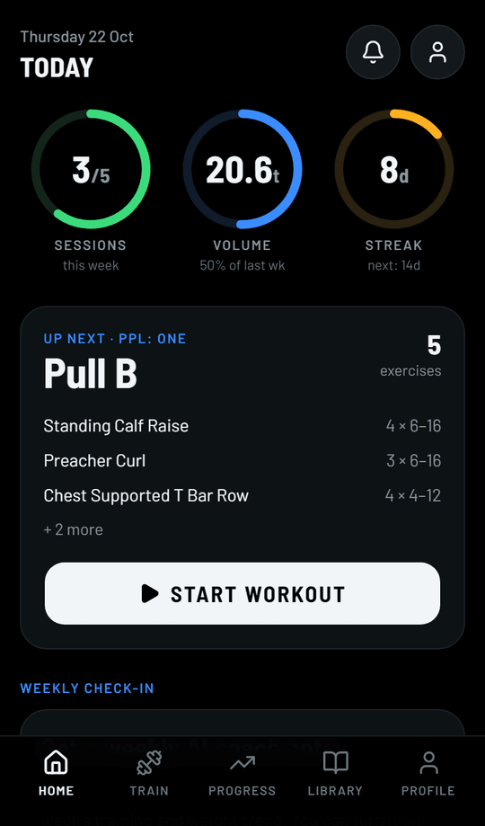
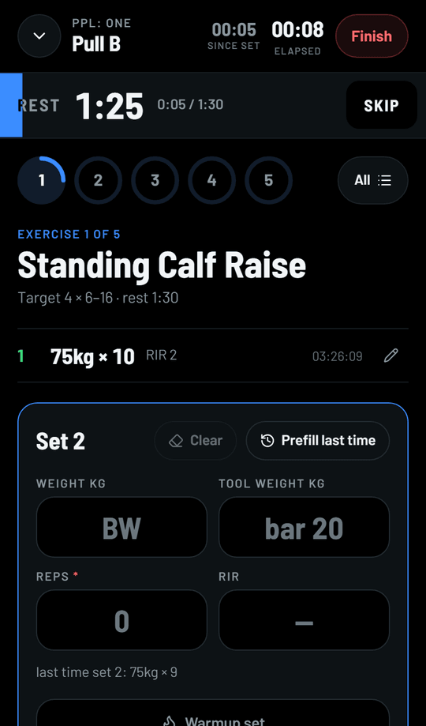
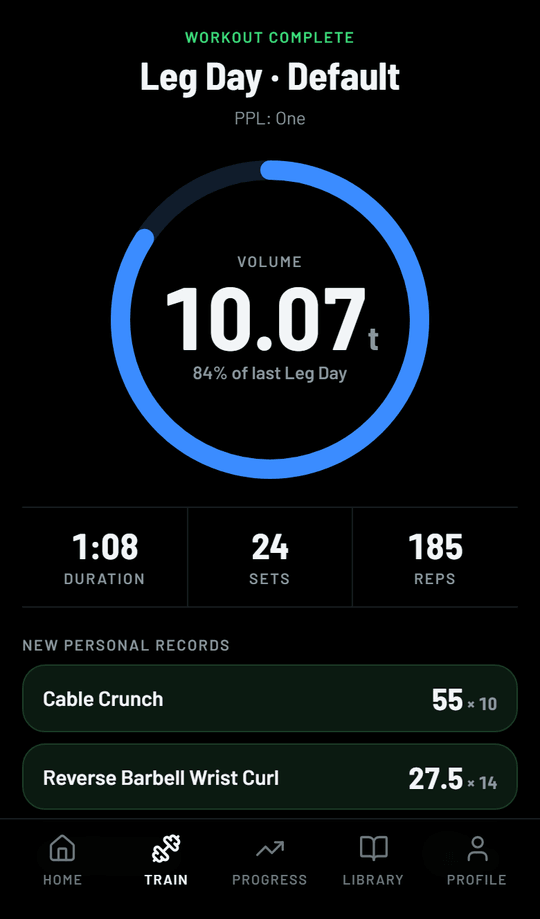
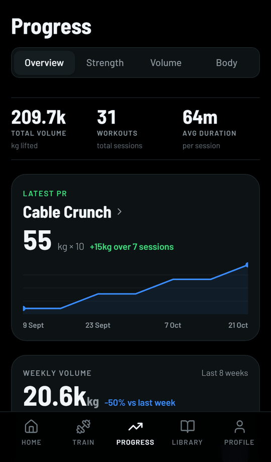
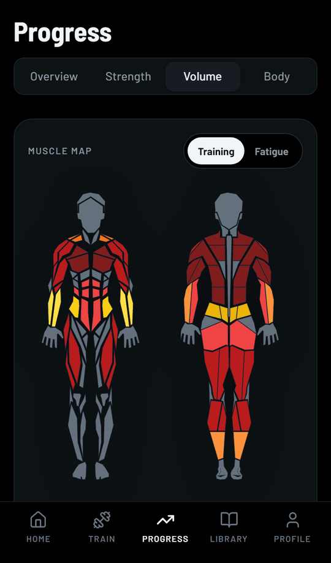
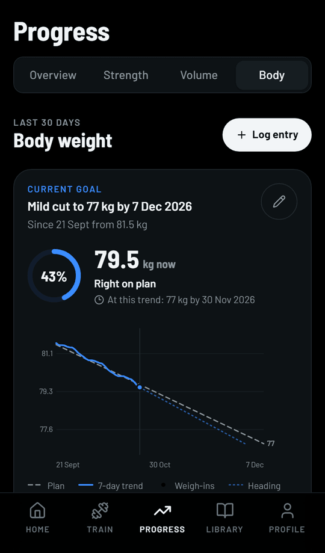

# gym-ledger/web

The Gym Ledger app for people who train: plan your week, log every set at the gym (with or without signal), and see your strength and body weight move over time. It is a mobile-first progressive web app that installs to the home screen.

Part of Gym Ledger, alongside [`gym-ledger/api`](https://github.com/gym-ledger/api) (the API every app talks to) and [`gym-ledger/admin`](https://github.com/gym-ledger/admin) (where the exercise library and system plans are managed).

## Screenshots

<p align="center"></p>

<table>
  <tr>
    <td></td>
    <td></td>
    <td></td>
  </tr>
  <tr>
    <td></td>
    <td></td>
    <td></td>
  </tr>
</table>

The data shown belongs to a demo account.

## Features

- **Workout logging built for the gym floor.** One exercise at a time, big numbers, a rest timer that fills as you rest and buzzes when it's done. Warm-up sets, drop sets, reps in reserve, effort and discomfort notes, and "last time" hints from your history.
- **Works offline.** Sets logged without signal are queued on the phone and synced when the connection returns; a workout can even be started offline. Screens you've opened before load from their last saved copy.
- **Plans.** Pick a public plan and get your own copy to edit: reorder exercises, change sets, reps, RIR and rest, or add an exercise for one workout or for good. When the original plan is updated, you can move your copy to the new version.
- **Progress.** Personal records with estimated one-rep max, weekly volume, a training-consistency streak, per-exercise history and a muscle map of what you've been training and what you've been skipping.
- **Body weight.** Daily weigh-ins with a moving-average trend, and weight goals (cut, maintain or bulk) with a suggested pace, a goal line on the chart and a history of past goals.
- **Weekly check-in.** A summary of each finished Monday–Sunday week; optionally (off by default, opt-in with consent) a short AI-written coaching note from those numbers. What is sent is listed in the app's privacy policy.
- **Your data, your call.** Download everything stored about you as a JSON file (prepared in the background, with a notification when it's ready), or delete your account: signed out everywhere at once, deleted for good after 30 days unless you sign in and cancel.
- **Sign-in without passwords.** A 6-digit code by email (or WhatsApp, if the instance enables it), with an optional password. A self-hosted proof-of-work CAPTCHA protects the "send code" step; no third-party CAPTCHA service.

## Tech stack

| Layer | Technology |
|---|---|
| Framework | Next.js 16 (App Router) · React 19 · TypeScript |
| Styling | Tailwind CSS 4 · shadcn/ui · Radix UI |
| State | Zustand (offline queues, drafts) · TanStack Query |
| Animation | Framer Motion |
| Offline | Hand-written service worker (`public/sw.js`) + local queues (`src/lib/offline`) |
| Deployment | Docker (Next.js standalone output) |

## Run it

The quickest way to run the whole project (database, API, this app and the admin panel) is the one-command stack in the API repository: see [Run the whole stack](https://github.com/gym-ledger/api#run-the-whole-stack).

To work on this app alone against an API that is already running:

```bash
cp .env.example .env.local   # then set NEXT_PUBLIC_API_URL
npm install
npm run dev                  # http://localhost:3000
```

| Script | What it does |
|---|---|
| `npm run dev` | Development server with hot reload |
| `npm run build` | Production build |
| `npm run start` | Serve the production build |
| `npm run lint` | ESLint |

## Configuration

All of these are read at **build time** (they end up in the browser bundle), so set them before `npm run build` or `docker compose up --build`.

| Variable | Required | What it is |
|---|---|---|
| `NEXT_PUBLIC_API_URL` | yes | Public URL of the API, ending in `/api/v1`, as the user's browser reaches it (not `localhost` on a server) |
| `NEXT_PUBLIC_OPERATOR_NAME` | for a public instance | Who runs this instance, shown in the privacy policy |
| `NEXT_PUBLIC_PRIVACY_CONTACT_EMAIL` | for a public instance | Where users send data requests, shown in the privacy policy and terms |
| `NEXT_PUBLIC_TERMS_GOVERNING_LAW` | no | Whose laws govern the terms of use; defaults to `India` |

## Project layout

```
src/
├── app/            routes: (auth) sign-in, (main) the signed-in app, onboarding, privacy
├── components/     feature components (workout, weight, progress, profile, …) and shared/ui
├── lib/api/        typed calls to the API, one file per area
├── lib/offline/    offline queues for sets and edits, the workout draft, the response cache
└── auth/           token handling, refresh across tabs, sign-out
```

`src/archive/` holds the pre-redesign UI for reference only; it isn't routed or imported.

## Deployment

See the [deployment guide](deployment/DEPLOY.md). On a server set up with the API's `deployment/ci/setup-server.sh`, every push to `main` deploys through GitHub Actions.

## Contributing and security

See [CONTRIBUTING.md](CONTRIBUTING.md). Please report vulnerabilities privately as described in [SECURITY.md](SECURITY.md).

## License

[MIT](LICENSE)
